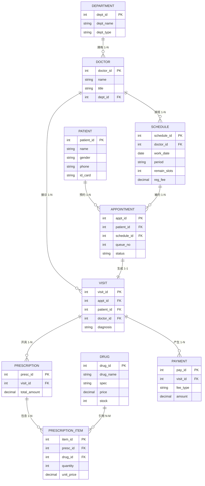

# 智慧医疗 · 社区门诊预约与处方管理系统
## 数据库设计方案（作业 1 · 关系型数据库应用 · 个人）

> 课程：数据库系统原理课程设计（2026-2027(1)）
> 技术栈：服务端 MySQL 8.0（部署于 Linux 虚拟机）+ 客户端 Python Flask（B/S 模式）
> 对应要求：≥5 张表、≥100,000 条数据、5~10 个实体、含 1-1 / 1-N / N-M 联系、3NF

---

## 1. 选题背景与应用场景

分级诊疗背景下，社区卫生服务中心承担着大量常见病、慢性病的首诊与分诊工作。患者"线下排队挂号 → 候诊 → 就诊 → 开方 → 缴费取药"的传统流程效率低、号源不可控、药品库存无法实时同步。

本系统面向**社区门诊**这一典型医疗业务场景，用关系型数据库承载以下核心业务链路：

```
建档 → 排班 → 预约挂号（扣号源） → 就诊（生成 1-1 就诊记录）
     → 开具处方（扣药品库存） → 处方明细 → 缴费结算
```

**为什么适合用关系型数据库**：医疗数据具有强一致性要求（号源不能超卖、库存不能为负、费用必须对账），实体之间以结构化、稳定的关系为主（科室-医生-排班-预约-就诊-处方-药品），需要 ACID 事务、多表连接统计与严格的完整性约束 —— 这正是 RDBMS 的强项。

---

## 2. 实体与联系

### 2.1 实体清单（10 个）

| # | 实体 | 说明 | 实测数据量 |
|---|---|---|---|
| 1 | 患者 Patient | 建档患者基本信息 | 5,000 |
| 2 | 科室 Department | 内科/外科/儿科等 | 30 |
| 3 | 医生 Doctor | 医生基本信息，隶属科室 | 300 |
| 4 | 排班 Schedule | 某医生某日某时段的号源 | 20,000 |
| 5 | 预约挂号 Appointment | 患者对排班的一次挂号 | 40,000 |
| 6 | 就诊记录 Visit | 挂号后的实际就诊（与预约 1-1） | 30,051 |
| 7 | 处方 Prescription | 一次就诊可开多张处方 | 21,916 |
| 8 | 药品 Drug | 药品字典与库存 | 500 |
| 9 | 处方明细 PrescriptionItem | 处方与药品的 N-M 联系表 | 60,000 |
| 10 | 缴费记录 Payment | 挂号费 / 药费结算流水 | 43,179 |

**合计 220,976 条**（远超 10 万条要求，且各表数据量分布贴近真实业务）。

### 2.2 联系清单（三种基数齐备）

| 联系 | 实体对 | 基数 | 说明 |
|---|---|---|---|
| 拥有 | 科室 — 医生 | **1-N** | 一个科室有多名医生，一名医生只属一个科室 |
| 排班 | 医生 — 排班 | **1-N** | 一名医生有多个出诊排班 |
| 预约 | 患者 — 预约挂号 | **1-N** | 一名患者可多次挂号 |
| 被约 | 排班 — 预约挂号 | **1-N** | 一个排班可被多名患者预约 |
| 生成 | 预约挂号 — 就诊记录 | **1-1** ⭐ | 一次成功挂号最多生成一条就诊记录 |
| 接诊 | 医生 — 就诊记录 | **1-N** | 一名医生接诊多位患者 |
| 开具 | 就诊记录 — 处方 | **1-N** | 一次就诊可开多张处方 |
| 包含 | 处方 — 处方明细 | **1-N** | 一张处方含多条明细 |
| 引用 | 药品 — 处方明细 | **N-M** ⭐ | 一张处方含多种药，一种药可出现在多张处方（经处方明细分解） |
| 产生 | 就诊记录 — 缴费记录 | **1-N** | 一次就诊产生挂号费、药费等多笔缴费 |

> ⭐ 是本设计的两个关键得分点：**1-1**（预约↔就诊）与 **N-M**（处方↔药品）。

### 2.3 ER 图



---

## 3. 关系模式（ER 图 → 关系模式）

主键用 **下划线** 表示，外键用 *斜体* 表示。

```
Department(dept_id, dept_name, dept_type, location, phone, status)
Patient(patient_id, patient_name, gender, birth_date, phone, id_card,
        medical_card_no, create_time, status)
Doctor(doctor_id, doctor_name, gender, title, dept_id*, phone,
       hire_date, intro, status)
Schedule(schedule_id, doctor_id*, work_date, period, total_slots,
         remain_slots, reg_fee, room)
Appointment(appt_id, patient_id*, schedule_id*, appt_time, queue_no, status)
Visit(visit_id, appt_id*, patient_id*, doctor_id*, visit_time,
      chief_complaint, diagnosis, advice)
Prescription(presc_id, visit_id*, presc_time, presc_type, status)
Drug(drug_id, drug_name, spec, unit, manufacturer, price, stock, is_rx, status)
PrescriptionItem(item_id, presc_id*, drug_id*, quantity, usage_note, unit_price)
Payment(pay_id, visit_id*, fee_type, amount, pay_method, pay_time, status)
```

**约束说明**

| 约束 | 内容 |
|---|---|
| 主键 | 每表 `*_id` 自增主键 |
| 外键 | `Doctor.dept_id → Department`；`Schedule.doctor_id → Doctor`；`Appointment.patient_id → Patient`；`Appointment.schedule_id → Schedule`；`Visit.appt_id → Appointment`（**唯一**，实现 1-1）；`Visit.patient_id/doctor_id → Patient/Doctor`；`Prescription.visit_id → Visit`；`PrescriptionItem.presc_id/drug_id → Prescription/Drug`；`Payment.visit_id → Visit` |
| 唯一 | `Patient.phone`、`Patient.id_card`、`Department.dept_name`、`Schedule(doctor_id, work_date, period)` |
| 检查 | `Schedule.remain_slots >= 0 AND remain_slots <= total_slots`；`Drug.stock >= 0`；`PrescriptionItem.quantity > 0`；`Payment.amount >= 0` |

> **1-1 的实现要点**：`Visit.appt_id` 上加 **UNIQUE 约束**，从数据库层面保证"一次预约最多一条就诊记录"，这是把 1-1 落实为物理约束的关键，报告中必须说明。

---

## 4. 规范化检查（3NF）

**函数依赖分析**（逐表检查是否存在部分依赖、传递依赖）：

| 表 | 候选键 | 函数依赖 | 判定 |
|---|---|---|---|
| Patient | patient_id | patient_id → 其余全部属性 | 3NF |
| Doctor | doctor_id | doctor_id → 其余；dept_id 是外键，`dept_name` 不冗余存 | 3NF |
| Schedule | schedule_id；候选键 (doctor_id, work_date, period) | schedule_id → 其余；非主属性均完全依赖于键 | 3NF |
| Appointment | appt_id | appt_id → patient_id, schedule_id, appt_time, queue_no, status | 3NF |
| Visit | visit_id | visit_id → appt_id(唯一), patient_id, doctor_id, 诊断信息 | 3NF |
| PrescriptionItem | item_id | item_id → presc_id, drug_id, quantity, usage_note, unit_price | 3NF |

**为达成 3NF 而刻意做的设计决策（报告重点）：**

1. **不冗余科室名称**：`Doctor` 只存 `dept_id`，不存 `dept_name`。否则 `doctor_id → dept_id → dept_name` 构成传递依赖，违反 3NF。
2. **不存储挂号费副本**：挂号费用存在 `Schedule.reg_fee`，`Appointment` 不复制该字段（若复制则 `appt_id → schedule_id → reg_fee` 为传递依赖）。
3. **不存储派生列**：不存 `PrescriptionItem.subtotal`（= quantity × unit_price）、不存 `Prescription.total_amount`（= 明细求和），这两个都是可计算列，属冗余，查询时用 `SUM()` / 视图得出。
4. **保留 `PrescriptionItem.unit_price` 的理由**：药品 `Drug.price` 是**当前售价**，而处方明细上的单价是**开方当时的成交价**，二者是不同语义的事实（药品调价后历史处方金额不能变），因此不构成 3NF 违规，属于必要的时态快照。
5. **N-M 联系必须独立成表**：`Prescription ↔ Drug` 的多对多联系拆解为 `PrescriptionItem(item_id, presc_id, drug_id, ...)`，消除多值依赖。

**结论：所有关系模式均已达到第三范式（3NF）**，无部分依赖与传递依赖（上述第 4 点已单独论证）。

---

## 5. 表结构详细设计（DDL）

> 完整可执行脚本见同目录 `sql/schema.sql`（含建库、建表、约束、注释、字符集设置）。

```sql
CREATE DATABASE IF NOT EXISTS outpatient_db
  DEFAULT CHARACTER SET utf8mb4 COLLATE utf8mb4_general_ci;
USE outpatient_db;

CREATE TABLE department (
  dept_id    INT AUTO_INCREMENT PRIMARY KEY,
  dept_name  VARCHAR(50)  NOT NULL,
  dept_type  VARCHAR(20)  NOT NULL,
  location   VARCHAR(50),
  phone      VARCHAR(20),
  status     TINYINT      NOT NULL DEFAULT 1,
  UNIQUE KEY uk_dept_name (dept_name)
) ENGINE=InnoDB;

CREATE TABLE patient (
  patient_id      INT AUTO_INCREMENT PRIMARY KEY,
  patient_name    VARCHAR(50) NOT NULL,
  gender          CHAR(1)     NOT NULL,
  birth_date      DATE,
  phone           VARCHAR(20) NOT NULL,
  id_card         VARCHAR(18) NOT NULL,
  medical_card_no VARCHAR(20),
  create_time     DATETIME    NOT NULL DEFAULT CURRENT_TIMESTAMP,
  status          TINYINT     NOT NULL DEFAULT 1,
  UNIQUE KEY uk_patient_phone (phone),
  UNIQUE KEY uk_patient_idcard (id_card)
) ENGINE=InnoDB;

CREATE TABLE doctor (
  doctor_id  INT AUTO_INCREMENT PRIMARY KEY,
  doctor_name VARCHAR(50) NOT NULL,
  gender     CHAR(1)     NOT NULL,
  title      VARCHAR(20) NOT NULL,
  dept_id    INT         NOT NULL,
  phone      VARCHAR(20),
  hire_date  DATE,
  intro      VARCHAR(200),
  status     TINYINT     NOT NULL DEFAULT 1,
  CONSTRAINT fk_doctor_dept FOREIGN KEY (dept_id) REFERENCES department(dept_id)
) ENGINE=InnoDB;

CREATE TABLE schedule (
  schedule_id  INT AUTO_INCREMENT PRIMARY KEY,
  doctor_id    INT  NOT NULL,
  work_date    DATE NOT NULL,
  period       VARCHAR(10) NOT NULL,
  total_slots  INT  NOT NULL,
  remain_slots INT  NOT NULL,
  reg_fee      DECIMAL(8,2) NOT NULL DEFAULT 0,
  room         VARCHAR(20),
  UNIQUE KEY uk_schedule (doctor_id, work_date, period),
  CONSTRAINT fk_schedule_doctor FOREIGN KEY (doctor_id) REFERENCES doctor(doctor_id),
  CONSTRAINT ck_schedule_slots CHECK (remain_slots >= 0 AND remain_slots <= total_slots)
) ENGINE=InnoDB;

CREATE TABLE appointment (
  appt_id     INT AUTO_INCREMENT PRIMARY KEY,
  patient_id  INT NOT NULL,
  schedule_id INT NOT NULL,
  appt_time   DATETIME NOT NULL DEFAULT CURRENT_TIMESTAMP,
  queue_no    INT NOT NULL,
  status      VARCHAR(10) NOT NULL DEFAULT '已预约',
  CONSTRAINT fk_appt_patient  FOREIGN KEY (patient_id)  REFERENCES patient(patient_id),
  CONSTRAINT fk_appt_schedule FOREIGN KEY (schedule_id) REFERENCES schedule(schedule_id)
) ENGINE=InnoDB;

CREATE TABLE visit (
  visit_id        INT AUTO_INCREMENT PRIMARY KEY,
  appt_id         INT NOT NULL,
  patient_id      INT NOT NULL,
  doctor_id       INT NOT NULL,
  visit_time      DATETIME NOT NULL,
  chief_complaint VARCHAR(500),
  diagnosis       VARCHAR(500),
  advice          VARCHAR(500),
  UNIQUE KEY uk_visit_appt (appt_id),          -- 实现 1-1 的关键约束
  CONSTRAINT fk_visit_appt    FOREIGN KEY (appt_id)    REFERENCES appointment(appt_id),
  CONSTRAINT fk_visit_patient FOREIGN KEY (patient_id) REFERENCES patient(patient_id),
  CONSTRAINT fk_visit_doctor  FOREIGN KEY (doctor_id)  REFERENCES doctor(doctor_id)
) ENGINE=InnoDB;

CREATE TABLE prescription (
  presc_id   INT AUTO_INCREMENT PRIMARY KEY,
  visit_id   INT NOT NULL,
  presc_time DATETIME NOT NULL DEFAULT CURRENT_TIMESTAMP,
  presc_type VARCHAR(10) NOT NULL,
  status     VARCHAR(10) NOT NULL DEFAULT '已开方',
  CONSTRAINT fk_presc_visit FOREIGN KEY (visit_id) REFERENCES visit(visit_id)
) ENGINE=InnoDB;

CREATE TABLE drug (
  drug_id      INT AUTO_INCREMENT PRIMARY KEY,
  drug_name    VARCHAR(100) NOT NULL,
  spec         VARCHAR(50),
  unit         VARCHAR(10),
  manufacturer VARCHAR(100),
  price        DECIMAL(8,2) NOT NULL,
  stock        INT NOT NULL DEFAULT 0,
  is_rx        TINYINT NOT NULL DEFAULT 1,
  status       TINYINT NOT NULL DEFAULT 1,
  CONSTRAINT ck_drug_stock CHECK (stock >= 0)
) ENGINE=InnoDB;

CREATE TABLE prescription_item (
  item_id    INT AUTO_INCREMENT PRIMARY KEY,
  presc_id   INT NOT NULL,
  drug_id    INT NOT NULL,
  quantity   INT NOT NULL,
  usage_note VARCHAR(100),
  unit_price DECIMAL(8,2) NOT NULL,
  CONSTRAINT fk_item_presc FOREIGN KEY (presc_id) REFERENCES prescription(presc_id),
  CONSTRAINT fk_item_drug  FOREIGN KEY (drug_id)  REFERENCES drug(drug_id),
  CONSTRAINT ck_item_qty   CHECK (quantity > 0)
) ENGINE=InnoDB;

CREATE TABLE payment (
  pay_id     INT AUTO_INCREMENT PRIMARY KEY,
  visit_id   INT NOT NULL,
  fee_type   VARCHAR(10) NOT NULL,
  amount     DECIMAL(10,2) NOT NULL,
  pay_method VARCHAR(10),
  pay_time   DATETIME NOT NULL DEFAULT CURRENT_TIMESTAMP,
  status     VARCHAR(10) NOT NULL DEFAULT '已支付',
  CONSTRAINT fk_pay_visit FOREIGN KEY (visit_id) REFERENCES visit(visit_id),
  CONSTRAINT ck_pay_amount CHECK (amount >= 0)
) ENGINE=InnoDB;
```

---

## 6. 数据规模规划（≥100,000 条）

由 `sql/data_gen.py` 脚本用 Python 批量生成（仅依赖 `pymysql` + 标准库，`--seed` 可复现），保证外键引用完整、业务逻辑自洽（号源 = 总数 − 未取消预约、明细单价与药品单价一致）。**实测结果（seed=2026）：**

| 表 | 实测行数 | 生成要点 |
|---|---:|---|
| department | 30 | 内科、外科、儿科、妇科、口腔科… |
| doctor | 300 | 每科室 10 名，职称按 10/20/45/25 分布 |
| patient | 5,000 | 随机姓名/手机号/身份证（含校验位计算） |
| drug | 500 | 85 种真实药品（名称与剂型/规格严格对应）× 14 家厂商 = 1190 种组合，同药不同厂家价格浮动 ±25% |
| schedule | 20,000 | 近 1 年，每医生每工作日 1~2 个时段，号源 15~40 |
| appointment | 40,000 | 状态：已就诊 30,051 / 已预约 5,954 / 已取消 3,995 |
| visit | 30,051 | 与"已就诊"预约严格 1-1 对应 |
| prescription | 21,916 | 约 73% 的就诊开具处方 |
| prescription_item | 60,000 | 每张处方 1~5 条明细，拆分 N-M 联系 |
| payment | 43,179 | 每就诊 1 条挂号费 + 有处方者 1 条药费 |
| **合计** | **220,976** | **✓ 满足 ≥100,000 条要求** |

> 已在 MySQL 8.0.45 实机执行：**写入耗时约 5.3 秒**，`verify.sql` 的 7 项完整性检查全部返回 0 行（号源越界、号源与预约不一致、预约被重复就诊、就诊记录挂空预约、处方单价与药价不符、孤立外键）。

---

## 7. 索引设计（含对照实验）

| 索引 | 表(列) | 目的 |
|---|---|---|
| 主键索引 | 各表 `*_id` | 自动 |
| 唯一索引 | `patient(phone)`、`patient(id_card)`、`department(dept_name)`、`schedule(doctor_id,work_date,period)`、`visit(appt_id)` | 唯一性 + 查询加速 |
| 普通索引 | `appointment(patient_id)`、`appointment(schedule_id)`、`appointment(status, appt_time)` | 患者查号、排班查号、状态统计 |
| 普通索引 | `visit(patient_id)`、`visit(doctor_id)`、`prescription(visit_id)`、`prescription_item(presc_id)`、`prescription_item(drug_id)`、`payment(visit_id)`、`schedule(work_date)` | 多表 join 加速 |

**对照实验（报告素材）**：对 `visit(doctor_id)` 等索引先 `DROP` 再 `CREATE`，用 `EXPLAIN` + `SHOW PROFILES` 记录同一统计 SQL 的扫描行数与耗时，形成"加索引前 vs 加索引后"对比表。

---

## 8. 事务设计

| 事务 | 步骤 | 一致性要点 |
|---|---|---|
| **T1 挂号** | ① `SELECT remain_slots FROM schedule WHERE schedule_id=? FOR UPDATE` ② 判断 >0 ③ `UPDATE schedule SET remain_slots=remain_slots-1` ④ `INSERT INTO appointment` ⑤ `COMMIT` / 否则 `ROLLBACK` | 行锁防止**号源超卖** |
| **T2 开具处方** | ① `INSERT INTO prescription` ② 循环 `INSERT INTO prescription_item` + `UPDATE drug SET stock=stock-?`（校验库存充足）③ 任一步失败整体 `ROLLBACK` | 处方与扣库存**同生共死** |
| **T3 退号** | ① `UPDATE appointment SET status='已取消'` ② `UPDATE schedule SET remain_slots=remain_slots+1` | 号源归还 |
| **T4 缴费** | ① `INSERT INTO payment` ② `UPDATE appointment SET status='已就诊'` | 费用与状态同步 |

Python 侧用 `pymysql` 的 `conn.begin()` / `conn.commit()` / `conn.rollback()` 控制，并**故意注入异常**演示回滚效果（报告中给出回滚前后数据对比截图）。

---

## 9. 多客户端并发与性能测试方案

用 `tools/concurrency_test.py`（`threading` + `concurrent.futures`）模拟 N 个客户端并发访问：

1. **并发挂号压测**：100 / 200 / 500 线程同时抢同一排班，验证 `remain_slots` 最终值正确且**不为负**（事务+行锁的有效性证明）。
2. **性能指标记录**：总请求数、成功数、失败数、**TPS**、平均/最大响应时间，输出到 CSV。
3. **对照实验**：同一压测分别在"加索引 / 不加索引"、"单连接 / 连接池"两种条件下运行，形成性能对比图表。

→ 该方案直接对应要求中的"多用户（多客户端）同时访问数据库，同时记录它们的访问性能"。

---

## 10. Flask 客户端设计（B/S 模式）

```
作业1_智慧医疗门诊预约系统/
├── run.py                    # Flask 入口
├── webapp/
│   ├── config.py             # 数据库连接配置（指向 Linux 服务器 MySQL）
│   ├── db.py                 # 连接封装 + transaction() 事务上下文
│   ├── dao.py                # 数据访问层（手写 SQL，不引三方 ORM）
│   ├── services.py           # 挂号事务、并发抢号演示
│   ├── views.py              # 路由层：首页 / 药房采购工作台 / 挂号 / 索引对比
│   └── netprobe.py           # 自动发现 Ubuntu 服务器地址
├── templates/                # 4 个页面：要求对照 / 药房采购 / 挂号 / 索引对比
├── static/
├── sql/
│   ├── schema.sql            # 建表 DDL
│   ├── index.sql             # 索引
│   └── data_gen.py           # 10 万条数据生成脚本
└── tools/
    └── concurrency_test.py   # 并发性能测试
```

**页面（按课程要求做减法，只保留必需能力）：**
- **/ 首页**：课程要求逐条对照到功能入口 + 数据规模与连接详情
- **/ops 药房采购工作台**：业务流里完成建表 / 插入 / 修改 / 删除 / 删表，另含 5 表与 7 表 JOIN 报表
- **/register 挂号**：挂号事务（T1）+ 多线程并发抢号
- **/perf 索引对比**：同一查询走索引 / 全表扫描的 EXPLAIN 与耗时对照

---

## 11. 报告的"标志性实践"章节规划（5 个）

| # | 任务目标 | 实现代码要点 |
|---|---|---|
| 1 | 数据库建模与 DDL 建表 | ER 图 → 关系模式 → `schema.sql`（含外键、唯一、CHECK 约束） |
| 2 | 挂号事务与号源并发控制 | `SELECT ... FOR UPDATE` + `remain_slots` 校验 + 失败回滚，附超卖对比证明 |
| 3 | 索引优化与性能对比 | `EXPLAIN` + `SHOW PROFILES`，加/不加索引的扫描行数与耗时对照 |
| 4 | 多客户端并发访问与性能记录 | 线程池压测，TPS / 响应时间 / 成功率，输出 CSV 与图表 |
| 5 | 跨表复杂查询（≥3 表 join） | 医生开药金额 Top10（5 表）、患者完整就诊流水（7 表） |

**为什么这样切分**：正好覆盖要求里的 6 项基本操作（建表/增/删/改/删表/join）、3 项额外功能（事务/索引/多用户并发性能），每个实践都有"目标 + 代码 + 结果"，直接对应报告模板的"标志性实践 N：任务目标 / 实现代码"格式。

---

## 12. 下一步

1. 生成 `sql/schema.sql`（建表 DDL，可直接在 Linux MySQL 执行）
2. 生成 `sql/data_gen.py`（10 万+ 条数据）
3. 生成 `sql/index.sql`（索引）
4. 搭建 Flask 客户端（dao / service / views / templates）
5. 编写 `tools/concurrency_test.py`（并发性能测试）
6. 整理项目报告文档（按"标志性实践"格式）
