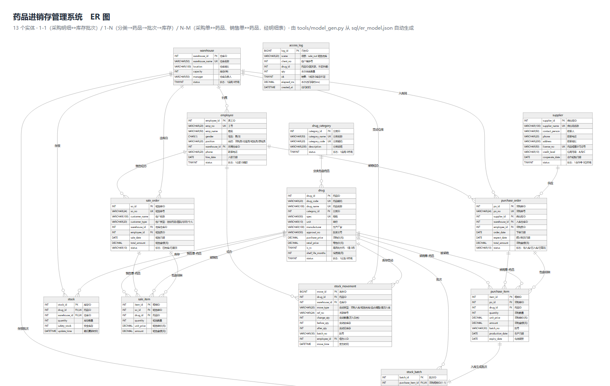
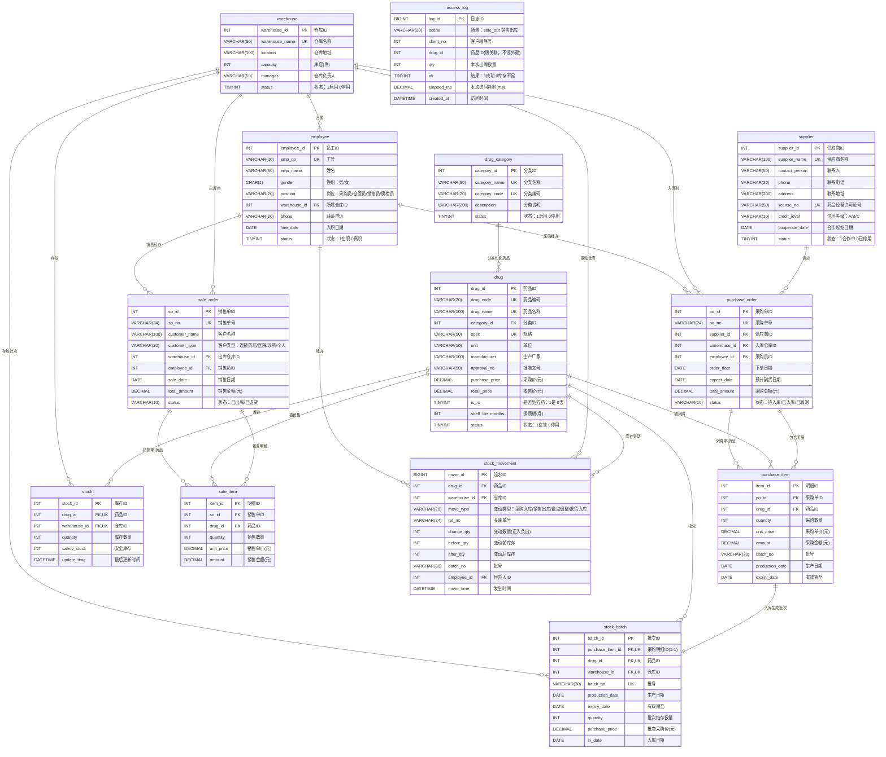

# 药品进销存管理系统
## 数据库设计方案（作业 1 · 关系型数据库应用 · 个人）

> 课程：数据库系统原理课程设计（2026-2027(1)）
> 技术栈：服务端 MySQL 8.0（部署于 Linux 虚拟机）+ 客户端 Python Flask（B/S 模式）
> 对应要求：≥5 张表、≥100,000 条数据、5~10 个实体、含 1-1 / 1-N / N-M 联系、3NF

---

## 1. 选题背景与应用场景

医药流通企业（区域药品批发商、连锁药房配送中心）的核心业务是"**进了多少、放在哪、卖出多少、账上还剩多少**"。这门生意的难点不在单据录入，而在三件事：

1. **批次与效期**——同一品种有多批货，批号不同、有效期不同，出库必须先出近效期的，过期批次必须能拦住；
2. **账实一致**——库存数量是"结存"，批次数量是"明细"，两者必须始终对得上；每一次变动都要有流水，能回答"这 100 盒是怎么变成 80 盒的"；
3. **并发不超卖**——多个销售员/开票窗口同时对同一品种出库，不能出现"账上 10 盒、卖出去 12 盒"。

本系统用关系型数据库承载这条完整业务链路：

```
分类/供应商/仓库/员工建档 → 采购下单 → 采购入库（生成批次 + 效期）
     → 库存结存（药品 × 仓库） → 销售出库（近效期先出） → 库存流水（账面连续）
     → 批次溯源（批号 → 采购单 → 供应商）
```

**为什么适合用关系型数据库**：这批数据的结构极其稳定（药品、供应商、仓库、单据、明细），且强一致要求明确——外键必须拦住孤立记录、库存不能为负、流水前后数量必须闭合、单据金额必须等于明细之和。这些正是 ACID 事务、多表连接与完整性约束的用武之地；同时业务上大量依赖"跨表核对"（供应商供货排行、药品销售排行、批次溯源），关系模型 + JOIN 是天然表达方式。

---

## 2. 实体与联系

### 2.1 实体清单（13 个）

| # | 实体 | 表名 | 说明 | 实测数据量 |
|---|---|---|---|---|
| 1 | 药品分类 DrugCategory | `drug_category` | 抗感染、心血管、消化系统…共 12 类 | 12 |
| 2 | 供应商 Supplier | `supplier` | 采购往来单位，含经营许可证号与信用等级 | 80 |
| 3 | 仓库 Warehouse | `warehouse` | 6 个仓（常温库/阴凉库/冷藏库/中药库…） | 6 |
| 4 | 员工 Employee | `employee` | 采购员/仓管员/销售员/质检员，隶属仓库 | 60 |
| 5 | 药品 Drug | `drug` | 药品字典：编码、名称、规格、厂家、采购价、零售价 | 1,200 |
| 6 | 采购单 PurchaseOrder | `purchase_order` | 向供应商下单的单据头 | 3,503 |
| 7 | 采购明细 PurchaseItem | `purchase_item` | 单据行，一行 = 一个批号/效期 | 15,695 |
| 8 | 库存 Stock | `stock` | 药品在仓库的结存（药品 × 仓库 唯一） | 6,360 |
| 9 | 库存批次 StockBatch | `stock_batch` | 入库生成的批次，保留批号与有效期 | 15,275 |
| 10 | 销售单 SaleOrder | `sale_order` | 出库单据头，客户为连锁药店/医院/诊所/个人 | 12,031 |
| 11 | 销售明细 SaleItem | `sale_item` | 单据行 | 41,500 |
| 12 | 库存流水 StockMovement | `stock_movement` | 每次库存变动的账目（正入负出，前后数量闭合） | 57,350 |
| 13 | 访问日志 AccessLog | `access_log` | 并发访问逐条记录的响应耗时（弱关联，不设外键） | 运行时写入 |

**合计 153,072 条**（不含运行期不断追加的访问日志），远超 10 万条要求。

### 2.2 联系清单（三种基数齐备，共 21 条）

| 联系 | 实体对 | 基数 | 说明 |
|---|---|---|---|
| 归类 | 药品分类 — 药品 | **1-N** | 一个分类下多种药品 |
| 供应 | 供应商 — 采购单 | **1-N** | 一家供应商可多次供货 |
| 归属 | 仓库 — 员工 | **1-N** | 员工在某个仓库任职 |
| 入库 | 仓库 — 采购单 | **1-N** | 采购单指定入库仓 |
| 经办 | 员工 — 采购单 | **1-N** | 采购员经办多张单 |
| 含行 | 采购单 — 采购明细 | **1-N** | 一单多行 |
| 被采购 | 药品 — 采购明细 | **1-N** | 一种药可出现在多张单 |
| 生成批次 | 采购明细 — 库存批次 | **1-1** ⭐ | 一行明细入库生成且仅生成一个批次 |
| 结存 | 药品 — 库存 | **1-N** | 一种药在多个仓各有结存 |
| 存放 | 仓库 — 库存 | **1-N** | 一个仓存放多个品种 |
| 分批 | 药品 — 库存批次 | **1-N** | 一种药有多个批次 |
| 仓批 | 仓库 — 库存批次 | **1-N** | 批次落在具体仓库 |
| 出库 | 仓库 — 销售单 | **1-N** | 销售单从某仓出库 |
| 经办 | 员工 — 销售单 | **1-N** | 销售员经办多张单 |
| 含行 | 销售单 — 销售明细 | **1-N** | 一单多行 |
| 被销售 | 药品 — 销售明细 | **1-N** | 一种药可被多次销售 |
| 变动 | 药品 — 库存流水 | **1-N** | 一种药多条流水 |
| 变动仓 | 仓库 — 库存流水 | **1-N** | 流水落在具体仓库 |
| 经办 | 员工 — 库存流水 | **1-N** | 每笔变动有经办人 |
| 采购 N-M | 采购单 ↔ 药品 | **N-M** ⭐ | 一单多种药，一种药在多张单（经 `purchase_item` 拆解） |
| 销售 N-M | 销售单 ↔ 药品 | **N-M** ⭐ | 一单多种药，一种药在多张单（经 `sale_item` 拆解） |

> ⭐ 是三个关键得分点：**1-1**（采购明细 ↔ 库存批次）、**N-M**（采购单 ↔ 药品、销售单 ↔ 药品）。
> 21 条联系中有 19 条由真实外键约束落地（DBA 可查），2 条 N-M 由双外键桥接表落地。

### 2.3 ER 图



> 上图由建模文件 `sql/er_model.json` 经 `tools/model_gen.py` 自动生成（Mermaid 源码 → `tools/render_er.py` 渲染为 PNG），
> 与 `sql/schema_generated.sql` 同源，实体名、字段名、主外键与数据库完全一致。

<details>
<summary>点开查看 ER 图 Mermaid 源码（Typora / VSCode / GitHub 可直接渲染）</summary>



</details>

### 2.4 建模工具与代码自动生成

> 对应课程要求 3：「能够应用数据库建模工具进行数据库建模，数据库代码自动生成」。

本系统的建模完全走「**模型 → 代码自动生成**」链路，而不是手写 DDL：

```
sql/er_model.json          ← 模型文件：13 个实体、全部属性/类型/约束、
        │                    主键/唯一键/索引/外键/CHECK、21 条联系
        ▼
tools/model_gen.py         ← 生成器：读模型 → 自动产出建表 DDL + Mermaid ER 图
        │
        ├── sql/schema_generated.sql   自动生成的建表脚本（13 表，256 行）
        └── --verify                   在真实 MySQL 中建两个临时库，把生成脚本与
                                       手工排版版 schema.sql 逐表比对结构
```

**实测校验结果**：`python tools/model_gen.py --verify …` 输出 —— 13 张表的列、类型、默认值、主键、唯一键、普通索引、外键、CHECK **完全一致 ✔**

要点：

- **单一事实来源**：改模型（如给 `drug` 加一列）只需改 `er_model.json`，重跑生成器即得新 DDL，不必手工同步多处；
- **拓扑校验**：生成前自动检查"外键引用的表是否先建"，避免 DDL 执行顺序错误（本库有 13 张表、19 个外键，顺序错了必然建表失败）；
- **可复现校验**：`--verify` 会在真库中同时加载两份脚本并逐表 diff，保证"模型 → 代码"与"手工交付脚本"永不漂移。

---

## 3. 关系模式（ER 图 → 关系模式）

主键用 **下划线** 表示，外键用 *斜体* 表示。

```
DrugCategory(category_id, category_name, category_code, description, status)
Supplier(supplier_id, supplier_name, contact_person, phone, address,
         license_no, credit_level, cooperate_date, status)
Warehouse(warehouse_id, warehouse_name, location, capacity, manager, status)
Employee(employee_id, emp_no, emp_name, gender, position, warehouse_id*, phone,
         hire_date, status)
Drug(drug_id, drug_code, drug_name, category_id*, spec, unit, manufacturer,
     approval_no, purchase_price, retail_price, is_rx, shelf_life_months, status)
PurchaseOrder(po_id, po_no, supplier_id*, warehouse_id*, employee_id*,
              order_date, expect_date, total_amount, status)
PurchaseItem(item_id, po_id*, drug_id*, quantity, unit_price, amount,
             batch_no, production_date, expiry_date)
Stock(stock_id, drug_id*, warehouse_id*, quantity, safety_stock, update_time)
StockBatch(batch_id, purchase_item_id*, drug_id*, warehouse_id*, batch_no,
           production_date, expiry_date, quantity, purchase_price, in_date)
SaleOrder(so_id, so_no, customer_name, customer_type, warehouse_id*, employee_id*,
          sale_date, total_amount, status)
SaleItem(item_id, so_id*, drug_id*, quantity, unit_price, amount)
StockMovement(move_id, drug_id*, warehouse_id*, move_type, ref_no, change_qty,
              before_qty, after_qty, batch_no, employee_id*, move_time)
AccessLog(log_id, scene, client_no, drug_id, qty, ok, elapsed_ms, created_at)
```

**约束说明**

| 约束类型 | 落地内容 |
|---|---|
| 主键 | 每表自增主键（`stock_movement.move_id`、`access_log.log_id` 用 BIGINT，因行数最多） |
| 外键（19 个） | `employee.warehouse_id`；`drug.category_id`；`purchase_order.supplier_id/warehouse_id/employee_id`；`purchase_item.po_id/drug_id`；`stock.drug_id/warehouse_id`；`stock_batch.purchase_item_id/drug_id/warehouse_id`；`sale_order.warehouse_id/employee_id`；`sale_item.so_id/drug_id`；`stock_movement.drug_id/warehouse_id/employee_id` |
| 唯一（13 个） | `uk_category_name`、`uk_category_code`、`uk_supplier_name`、`uk_supplier_license`、`uk_warehouse_name`、`uk_emp_no`、`uk_drug_code`、`uk_drug_name_spec(drug_name,spec)`、`uk_po_no`、`uk_stock_drug_wh(drug_id,warehouse_id)`、`uk_batch_purchase(purchase_item_id)`、`uk_batch_no(drug_id,warehouse_id,batch_no)`、`uk_so_no` |
| CHECK（13 个） | `ck_stock_qty(quantity>=0)`、`ck_batch_qty(quantity>=0)`、`ck_move_after(after_qty>=0)`、`ck_move_balance(after_qty = before_qty + change_qty)`、`ck_pi_qty(quantity>0)`、`ck_si_qty(quantity>0)`、`ck_drug_price`、`ck_po_amount`、`ck_so_amount`、`ck_pi_price`、`ck_si_amount`、`ck_stock_safety`、`ck_warehouse_capacity` |
| 索引 | 24 个普通索引（含 2 个复合索引 `idx_move_drug_time`、`idx_move_type_time`），见第 7 节 |

> **1-1 的实现要点**：`stock_batch.purchase_item_id` 上加 **UNIQUE 约束 `uk_batch_purchase`**，从数据库层面保证"一行采购明细最多生成一个批次"。这是把 1-1 落实为物理约束的关键——只靠应用代码判断会出现并发下重复插入。
>
> **N-M 的实现要点**：采购单与药品、销售单与药品都是多对多，各自拆出桥接表 `purchase_item`、`sale_item`，两张桥接表都以 `(单据头外键, drug_id)` 双外键落地。

---

## 4. 规范化检查（3NF）

**函数依赖分析**（逐表检查部分依赖与传递依赖）：

| 表 | 候选键 | 主要函数依赖 | 判定 |
|---|---|---|---|
| drug_category | category_id；另 (category_name)、(category_code) 唯一 | category_id → 其余全部 | 3NF |
| supplier | supplier_id；(supplier_name)、(license_no) 唯一 | supplier_id → 其余全部 | 3NF |
| warehouse | warehouse_id；(warehouse_name) 唯一 | warehouse_id → 其余全部 | 3NF |
| employee | employee_id；(emp_no) 唯一 | employee_id → 其余；只存 warehouse_id，不存仓库名 | 3NF |
| drug | drug_id；(drug_code)、(drug_name,spec) 唯一 | drug_id → 其余；只存 category_id | 3NF |
| purchase_order | po_id；(po_no) 唯一 | po_id → 其余 | 3NF |
| purchase_item | item_id | item_id → po_id, drug_id, quantity, unit_price, amount, 批次与效期 | 3NF |
| stock | stock_id；(drug_id, warehouse_id) 唯一 | stock_id → 其余 | 3NF |
| stock_batch | batch_id；(purchase_item_id) 唯一；(drug_id,warehouse_id,batch_no) 唯一 | batch_id → 其余 | 3NF |
| sale_order | so_id；(so_no) 唯一 | so_id → 其余 | 3NF |
| sale_item | item_id | item_id → so_id, drug_id, quantity, unit_price, amount | 3NF |
| stock_movement | move_id | move_id → 全部流水字段 | 3NF |
| access_log | log_id | log_id → 全部日志字段 | 3NF |

**为达成 3NF 而刻意做的设计决策（报告重点）：**

1. **库存不能挂在药品表上**。若写成 `drug.quantity`，多仓库场景就得存"1 号仓 100 / 2 号仓 50"，属于多值属性，违反 **1NF**。因此独立出 `stock(drug_id, warehouse_id, quantity)`，并以 `uk_stock_drug_wh` 保证"一药一仓一行"。
2. **不冗余分类名 / 仓库名 / 供应商名**。`drug` 只存 `category_id`、`purchase_order` 只存 `supplier_id`，避免 `drug_id → category_id → category_name` 这类传递依赖。
3. **不存派生列**。`purchase_item.amount`（= 数量 × 单价）与 `sale_item.amount` 虽然可算，但作为**明细行金额**保留属于单据必备字段；而"单据总金额"另有 `purchase_order.total_amount` / `sale_order.total_amount`，它在**同一事务内**由明细汇总写入，见第 5 点的说明。报表侧的"某药累计销量""某供应商供货总额"等一律用 `SUM()` 实时聚合，不落表。
4. **保留价格快照，且语义不同**：`drug.purchase_price / retail_price` 是**当前**价格；`purchase_item.unit_price` 是**下单时成交价**；`stock_batch.purchase_price` 是**该批入库成本**；`sale_item.unit_price` 是**出库时售价**。药品调价后，历史单据金额不能跟着变，所以这些"时态快照"属于不同语义的事实，不构成冗余。
5. **单据头金额的受控冗余**：`total_amount` 对主键 `po_id` 完全函数依赖，严格说**不违反 3NF**（3NF 只约束非主属性对候选键的传递依赖），但它确实带来更新异常风险。保留的理由是业务与对账需要"单据头的稳定总额"，控制手段是：写入只发生在 `receive_purchase()` 事务内、与明细同事务提交；校验手段是 `data_gen.py` 的 6 项自洽检查与 `verify.sql`。
6. **N-M 联系必须独立成表**：`采购单 ↔ 药品`、`销售单 ↔ 药品` 各拆一张明细表，消除多值依赖；明细表同时承载"数量 / 单价 / 金额"这些只属于该次交易的属性。
7. **日志表刻意不合规从严**：`access_log.drug_id` 只做弱关联、不设外键，因为它是"性能采样数据"，不应因药品主数据维护（停用/删除重建）而被阻塞或级联；这是有意识的取舍，在报告中作为"约束强度 vs 运维灵活度"的讨论点。

**结论：13 个关系模式全部达到第三范式（3NF）**，无部分依赖；上述第 5、7 点为经论证的受控冗余/弱关联。

---

## 5. 表结构详细设计

> 完整可执行脚本见 `sql/schema.sql`（含建库、建表、约束、列注释、字符集）。以下是结构总览与关键约束片段。

### 5.1 结构总览

| # | 表名 | 中文名 | 主键 | 关键字段 | 主要约束 |
|---|---|---|---|---|---|
| 1 | `drug_category` | 药品分类 | category_id | category_name、category_code | 名称/编码唯一 |
| 2 | `supplier` | 供应商 | supplier_id | supplier_name、license_no、credit_level | 名称/许可证唯一 |
| 3 | `warehouse` | 仓库 | warehouse_id | warehouse_name、capacity、manager | 名称唯一；库容 ≥0 |
| 4 | `employee` | 员工 | employee_id | emp_no、position、warehouse_id | 工号唯一；→ warehouse |
| 5 | `drug` | 药品 | drug_id | drug_code、drug_name+spec、purchase_price、retail_price、is_rx | 编码唯一；(名称,规格) 唯一；价格 ≥0 |
| 6 | `purchase_order` | 采购单 | po_id | po_no、supplier_id、warehouse_id、employee_id、total_amount、status | 单号唯一；金额 ≥0；3 外键 |
| 7 | `purchase_item` | 采购明细 | item_id | po_id、drug_id、quantity、unit_price、batch_no、expiry_date | 数量 >0；单价 ≥0 |
| 8 | `stock` | 库存 | stock_id | drug_id+warehouse_id、quantity、safety_stock | (药,仓) 唯一；数量 ≥0 |
| 9 | `stock_batch` | 库存批次 | batch_id | purchase_item_id、batch_no、expiry_date、quantity、purchase_price | 明细 1-1 唯一；(药,仓,批号) 唯一；结存 ≥0 |
| 10 | `sale_order` | 销售单 | so_id | so_no、customer_name、customer_type、warehouse_id、employee_id | 单号唯一；金额 ≥0 |
| 11 | `sale_item` | 销售明细 | item_id | so_id、drug_id、quantity、unit_price、amount | 数量 >0；金额 ≥0 |
| 12 | `stock_movement` | 库存流水 | move_id (BIGINT) | move_type、change_qty、before_qty、after_qty、ref_no、move_time | **after = before + change**；after ≥0 |
| 13 | `access_log` | 访问日志 | log_id (BIGINT) | scene、client_no、drug_id、elapsed_ms | 无外键（弱关联） |

### 5.2 关键约束片段

**① 1-1 联系（一行明细 ↔ 一个批次）**

```sql
CREATE TABLE stock_batch (
  `batch_id`         INT AUTO_INCREMENT COMMENT '批次ID',
  `purchase_item_id` INT           NOT NULL COMMENT '采购明细ID(1-1)',
  ...
  UNIQUE KEY uk_batch_purchase (purchase_item_id),      -- ★ 1-1 靠唯一索引落地
  UNIQUE KEY uk_batch_no (drug_id, warehouse_id, batch_no),
  CONSTRAINT fk_batch_item FOREIGN KEY (purchase_item_id) REFERENCES purchase_item (item_id),
  CONSTRAINT ck_batch_qty CHECK (quantity >= 0)
) ENGINE=InnoDB DEFAULT CHARSET=utf8mb4 COMMENT='库存批次表';
```

**② 账面闭合（流水的核心约束）**

```sql
CONSTRAINT ck_move_balance CHECK (after_qty = before_qty + change_qty),  -- 前后数量必须闭合
CONSTRAINT ck_move_after   CHECK (after_qty >= 0)                        -- 出库不能把账做成负数
```

这条 CHECK 让"流水"具备可审计性：任意一条流水只要前后数量对不上，写库就直接失败（错误码 3819），不依赖应用层自觉。

**③ 库存唯一性（一药一仓一行）**

```sql
UNIQUE KEY uk_stock_drug_wh (drug_id, warehouse_id),
CONSTRAINT ck_stock_qty CHECK (quantity >= 0)
```

**④ 药品不重复建档**

```sql
UNIQUE KEY uk_drug_name_spec (drug_name, spec)   -- 同名同规格只允许一条
```

### 5.3 关于界面上的"业务表单"（建表 / 删表演示）

`schema.sql` 只建 13 张核心业务表。界面上的「业务表单」由客户端在运行时 `CREATE TABLE bizform_xxx` 动态建表（如药品召回登记、库存盘点差异），属于课程要求"创建 / 删除数据表"的演示动作，**不写入 schema.sql**，避免污染核心结构。详见第 10 节。

---

## 6. 数据规模规划（≥100,000 条）

由 `sql/data_gen.py` 用 Python 批量生成（仅依赖 `pymysql` + 标准库，`--seed` 可复现）。它不是随机灌数，而是**按业务时间轴推演**：先造主数据，再造近一年的采购与销售单据，然后按 `(药品, 仓库)` 逐条推演库存与批次，最后生成流水。

**实测结果（seed=2026）：**

| 表 | 实测行数 | 生成要点 |
|---|---:|---|
| drug_category | 12 | 抗感染、心血管、消化、呼吸、内分泌、神经、五官、皮肤、中药、维生素、外用药、其他 |
| supplier | 80 | 名称含地域+类型（如"重庆药业有限公司"），许可证号唯一，信用 A/B/C 按 2:5:3 |
| warehouse | 6 | 常温库 / 阴凉库 / 冷藏库 / 中药库 / 高值药品库 / 退货待检库 |
| employee | 60 | 采购员 12 / 仓管员 18 / 销售员 24 / 质检员 6，工号 EMP0001… |
| drug | 1,200 | 12 个分类 × 每类 10~14 个真实药名 × 剂型剂量池，**规格与剂型严格匹配**（如"0.25g*24粒"）；价格按包装量推算，避免"24 粒装 160 元"的失真 |
| purchase_order | 3,503 | 近 12 个月，状态：已入库 97% / 待入库 3% |
| purchase_item | 15,695 | 每单 3~6 行，行内带批号与效期（效期 6~36 个月） |
| stock_batch | 15,275 | **仅"已入库"的明细才生成批次**（保证账实一致） |
| stock | 6,360 | 一药一仓一行，含安全库存 |
| sale_order | 12,031 | 近 12 个月，客户类型：连锁药店/医院/诊所/个人 |
| sale_item | 41,500 | 每单 1~5 行，单价取零售价 |
| stock_movement | 57,350 | 采购入库 + 销售出库 + 盘点调整，共 3 类，前后数量逐条连续 |
| **合计** | **153,072** | **✓ 满足 ≥100,000 条要求** |

**生成后的 6 项自洽校验（全部为 0 异常）：**

| 校验项 | 含义 |
|---|---|
| 库存结存 = 批次结存之和 | 账（`stock`）与实（`stock_batch`）必须对得上 |
| 流水 `after_qty = before_qty + change_qty` | 账面连续，无跳变 |
| 采购明细 `amount = quantity × unit_price` | 明细金额正确 |
| 销售明细 `amount = quantity × unit_price` | 明细金额正确 |
| 库存无负数 | 业务下限 |
| 批次结存无负数 | 业务下限 |

> 实机写入耗时约 **6.3 秒**（PyMySQL 批量 `executemany`）。数据质量上踩过两个坑并已修正：
> ① 早期"待入库"的采购单也生成了批次，导致 1,004 行账实不符；
> ② "盘点调整"只改了库存没同步批次，残留 632 行差异。修正后归零。

---

## 7. 索引设计（含对照实验）

全库共 **37 个二级索引**（13 个唯一索引 + 24 个普通索引，其中 5 个是多列复合索引；`information_schema.statistics` 按列展开计 43 条记录）。

| 类别 | 索引 | 表（列） | 目的 |
|---|---|---|---|
| 唯一 | `uk_drug_name_spec` | drug(drug_name, spec) | 防重复建档 + 名称检索 |
| 唯一 | `uk_stock_drug_wh` | stock(drug_id, warehouse_id) | 一药一仓一行 + 定位结存 |
| 唯一 | `uk_batch_purchase` | stock_batch(purchase_item_id) | 1-1 约束 |
| 唯一 | `uk_batch_no` | stock_batch(drug_id, warehouse_id, batch_no) | 同仓同批号不重复 |
| 单据 | `idx_po_supplier` / `idx_po_date` / `idx_po_status` | purchase_order | 按供应商、日期、状态查单 |
| 单据 | `idx_so_customer` / `idx_so_date` / `idx_so_warehouse` | sale_order | 按客户、日期、仓库查单 |
| 明细 | `idx_pi_po` / `idx_pi_drug` / `idx_pi_batch` | purchase_item | 单据展开、按药查采购、按批号追溯 |
| 明细 | `idx_si_so` / `idx_si_drug` | sale_item | 单据展开、按药查销售 |
| 库存 | `idx_stock_warehouse` / `idx_batch_expiry` / `idx_batch_drug` | stock / stock_batch | 仓库汇总、近效期扫描、按药查批次 |
| 流水 | `idx_move_drug_time` | stock_movement(drug_id, **move_time**) | 复合索引：按药 + 时间查流水（最左前缀） |
| 流水 | `idx_move_type_time` | stock_movement(move_type, move_time) | 按类型 + 时间统计 |
| 流水 | `idx_move_time` | stock_movement(move_time) | 按时间范围聚合（对比用例 2） |
| 日志 | `idx_log_time` / `idx_log_drug` | access_log | 按时间/药品查访问日志 |

**索引脚本可重复执行**：`sql/index.sql` 用存储过程 `add_index_if_missing` 封装"存在即跳过"，重复执行不会报错，也可作为"误删索引后的恢复脚本"。

**对照实验（实测）**：

| 用例 | 走索引 | `IGNORE INDEX` 全表扫描 | 提速 | 执行计划 |
|---|---:|---:|---:|---|
| 按药品查流水（`drug_id` + 时间） | **0.624 ms** | 8.639 ms | **13.84×** | `range` → `ALL`，扫描行数 ~5.7 万 → 数百 |
| 按时间范围统计流水（聚合） | **1.872 ms** | 9.692 ms | **5.18×** | `range` → `ALL` |

> 说明：对比统一用 `IGNORE INDEX` 而不是真删索引——既不修改库结构，又能在同一时刻、同一数据量下对比，结果更可信。

---

## 8. 事务设计

三个事务全部落在 `webapp/services.py`，用 `pymysql` 的 `begin/commit/rollback` 显式控制边界。

### T1 采购入库（6 张表同一事务）

```sql
START TRANSACTION;
  -- ① 单据头：置为已入库并写总额
  UPDATE purchase_order SET status='已入库', total_amount=? WHERE po_id=?;
  -- ② 明细行
  INSERT INTO purchase_item (po_id, drug_id, quantity, unit_price, amount,
                             batch_no, production_date, expiry_date) VALUES (...);
  -- ③ 批次（1-1，来自上面的 item_id）
  INSERT INTO stock_batch (purchase_item_id, drug_id, warehouse_id, batch_no,
                           production_date, expiry_date, quantity, purchase_price, in_date)
       VALUES (...);
  -- ④ 库存结存：有则加、无则建（★ 行锁）
  SELECT quantity FROM stock WHERE drug_id=? AND warehouse_id=? FOR UPDATE;
  UPDATE stock SET quantity = quantity + ? ...;      -- 或 INSERT INTO stock (...)
  -- ⑤ 流水（before/after 与实际结存一致）
  INSERT INTO stock_movement (drug_id, warehouse_id, move_type, ref_no,
                              change_qty, before_qty, after_qty, batch_no, employee_id)
       VALUES (...);
COMMIT;
```

**一致性要点**：5 组语句跨 6 张表，任一步失败整体 `ROLLBACK`——不会出现"批次建了但库存没加""流水加了但批次没建"的脏数据。

### T2 销售出库（行锁 + 近效期先出）

```sql
START TRANSACTION;
  SELECT quantity FROM stock
   WHERE drug_id=? AND warehouse_id=? FOR UPDATE;    -- ★ 先锁结存行
  -- 应用层校验：库存 ≥ 本次出库量，否则 ROLLBACK 并返回"库存不足"
  SELECT batch_id, quantity FROM stock_batch
   WHERE drug_id=? AND warehouse_id=? AND quantity>0 AND expiry_date > CURDATE()
   ORDER BY expiry_date ASC FOR UPDATE;              -- ★ 近效期先出（FIFO by 效期）
  -- 逐批扣减批次，直至扣完本次数量
  UPDATE stock_batch SET quantity = quantity - ? WHERE batch_id=?;
  INSERT INTO sale_order (...) VALUES (...);
  INSERT INTO sale_item  (...) VALUES (...);
  UPDATE stock SET quantity = quantity - ? WHERE drug_id=? AND warehouse_id=?;
  INSERT INTO stock_movement (...) VALUES (...);    -- change_qty 为负数
COMMIT;
```

**为什么先在 `stock` 加锁**：库存行的锁是"总闸门"，所有并发出库都要先过这一关，保证"检查库存 → 扣批次 → 扣结存"整段串行化，不会超卖；批次表再各自加锁，防止两个事务扣同一批。

**过期批次拦截**：`AND expiry_date > CURDATE()` 保证过期批次不参与出库，过期库存只能走"报损/退货"流程。

### T3 并发出库演示（10 终端同时抢同一品种）

页面 `/ops → 并发出库`：先把某个 `(药品, 仓库)` 的库存重置为 N，再用 `threading.Barrier` 让 10 个线程同时冲进去买 1 件，每个线程各自执行一次 T2 的完整事务，并把**本次访问耗时**写入 `access_log`。页面输出成功数、失败数、库存变化、总耗时、平均/最快/最慢响应、吞吐量，并用 `成功次数 == 库存减少量` 判定是否超卖。

**实测**：库存重置为 8 → 成功 8、失败 2、耗时 196.96 ms、库存 8→0、`oversold = False`，`access_log` 同步新增 10 条。

### 回滚演示

`tools/selfcheck_req.py` 第 5、6 项专门验证回滚：`INSERT` 两行后 `ROLLBACK`，药品数 1200 → 1200；`SELECT … FOR UPDATE` 锁行扣 1（529 → 528）后 `ROLLBACK`，复原为 529。

---

## 9. 多客户端并发与性能测试方案

两套互补的工具：

**① 页面内演示（小规模、可讲解）**：`/ops → 并发出库`，10 终端 × 1 件，看"无超卖"与"逐次耗时"。

**② 压测脚本（大规模、出数据）**：`tools/concurrency_test.py`，`threading` 起 N 个连接持续打 15 秒，三场景：

| 场景 | 操作组成 |
|---|---|
| `read` | 单表索引查询 + 多表 JOIN 统计 + 时间范围聚合 |
| `write` | 销售出库事务（`FOR UPDATE` + 扣库存 + 写流水）、采购入库补货 |
| `mixed` | 读写 7:3 |

**实测结果（10 客户端 × 6 秒，MySQL 与压测进程同机以排除网络干扰）：**

| 场景 | 总请求 | 成功率 | TPS | 平均 | P50 | P95 | P99 | 最大 |
|---|---:|---:|---:|---:|---:|---:|---:|---:|
| read | — | 100% | **496.2** | 19.60 ms | — | 57.22 ms | — | 96.11 ms |
| write | 1,115 | 100% | **184.2** | 52.86 ms | — | 60.94 ms | — | 125.92 ms |
| mixed | 3,299 | 100% | **545.2** | 17.86 ms | 15.04 ms | 46.02 ms | 67.78 ms | 119.38 ms |

mixed 场景的分操作耗时（能看出瓶颈在哪）：

| 操作 | 次数 | 平均 | P95 | 解读 |
|---|---:|---:|---:|---|
| index_query（单表索引查询） | 1,275 | **0.45 ms** | 0.63 ms | 索引命中，微秒级 |
| range_query（时间范围聚合） | 337 | 17.01 ms | 23.88 ms | 走 `idx_move_time` |
| join_query（5 表 JOIN 统计） | 706 | 41.76 ms | 56.68 ms | 报表类查询是主要耗时 |
| dispense（销售出库事务） | 681 | 23.26 ms | 41.07 ms | 行锁 + 5 张表写 |
| restock（采购入库） | 300 | 24.30 ms | 40.57 ms | 6 张表写 |

结论：**读吞吐 ≈ 2.7 倍于写吞吐**，符合"报表型查询多、写事务带行锁"的业务特征；写场景 TPS 184 且 100% 成功，说明行锁争用没有导致死锁或失败。

CSV 明细与按秒采样写入 `tools/concurrency_*.csv`（已在 `.gitignore` 中排除，属于运行产物）。

---

## 10. Flask 客户端设计（B/S 模式）

```
作业1_药品进销存系统/
├── run.py                      # Flask 入口
├── 启动客户端.bat               # Windows 一键启动
├── webapp/
│   ├── config.py               # 连接配置（可用环境变量覆盖）
│   ├── db.py                   # 连接封装 + transaction() 上下文
│   ├── dao.py                  # 数据访问层：全部手写 SQL，不用 ORM
│   ├── services.py             # 业务事务：采购入库 / 销售出库 / 并发出库
│   ├── views.py                # 路由层 + Ajax 接口 + 动态业务表单
│   └── netprobe.py             # 自动发现 Linux 服务器地址
├── templates/                  # 3 个页面：数据概览 / 进销存业务 / 索引对比
├── static/style.css            # 手写 CSS（无 Bootstrap / jQuery）
├── sql/                        # er_model.json / schema / index / verify / data_gen
├── tools/                      # 建模生成器、ER 渲染、连通自检、两个自检脚本、压测
└── deploy/                     # Linux 部署与开机自启脚本
```

**页面（按课程要求做减法，只保留必需能力）：**

| 页面 | 地址 | 内容 |
|---|---|---|
| 数据概览 | `/` | 数据总量、数据表数、库存结存、近效期批次；各表行数；服务器信息（主机名 / 版本 / 数据目录） |
| 进销存业务 | `/ops` | 5 个页签：药品目录 / 采购入库·销售出库 / 业务表单 / 运营报表 / 并发出库 |
| 索引对比 | `/perf` | 同一查询"走索引 / `IGNORE INDEX`"的 `EXPLAIN` + 实测耗时 |

**分层的好处**（报告可直接讲）：`views` 只管页面与参数校验，`services` 只管业务规则与事务边界，`dao` 只管 SQL，`db` 只管连接与提交回滚。改 SQL 不动页面，改页面不动事务。

---

## 11. 报告的"标志性实践"章节规划（5 个）

| # | 任务目标 | 实现要点 | 实测证据 |
|---|---|---|---|
| 1 | 数据库建模与 DDL 建表 | ER 图 → 关系模式 → `schema.sql`；模型驱动生成 + `--verify` 逐表比对 | 13 表结构完全一致 |
| 2 | 采购入库事务（6 表原子性） | 单据头 → 明细 → 批次 → 结存（`FOR UPDATE`）→ 流水，同一事务 | 失败即整体回滚 |
| 3 | 销售出库事务与并发控制 | 结存行锁 + 近效期先出 + 过期拦截 + 无超卖 | 10 终端 8→0，`oversold=False` |
| 4 | 索引优化与性能对比 | `EXPLAIN` + 实测耗时，走/不走索引对照 | 13.84× / 5.18× |
| 5 | 多客户端并发访问与性能记录 | 线程压测 + 逐次耗时入 `access_log` | read 496 / write 184 / mixed 545 TPS |

外加跨表复杂查询（4~7 表 JOIN 的四张报表），覆盖"跨数据表操作"要求。

---

## 12. 交付清单

| 类别 | 内容 |
|---|---|
| 建库脚本 | `sql/schema.sql`（13 表）、`sql/schema_generated.sql`（模型生成）、`sql/index.sql`（幂等索引） |
| 数据脚本 | `sql/data_gen.py`（15.3 万条，`--seed` 可复现，生成后自动跑 6 项校验） |
| 校验脚本 | `sql/verify.sql`（数据量 / 账实自洽 / 结构统计 / 业务样例 / 索引对比） |
| 建模 | `sql/er_model.json`、`sql/er_diagram.mmd`、`tools/model_gen.py`、`tools/render_er.py`、`docs/images/er_diagram.png` |
| 客户端 | `run.py`、`webapp/`（config / db / dao / services / views / netprobe / templates / static） |
| 工具 | `tools/check_conn.py`、`tools/selfcheck_req.py`（13 项）、`tools/selfcheck_api.py`（39 项）、`tools/concurrency_test.py` |
| 部署 | `deploy/`（Ubuntu 配置、建库灌数、WSL 一键、开机自启） |
| 文档 | `01`~`05` 五份 + `README.md` |
| 截图 | `docs/screens/` 7 张（数据概览 / 药品目录 / 采购入库与销售出库 / 业务表单 / 运营报表 / 并发出库 / 索引对比） |
